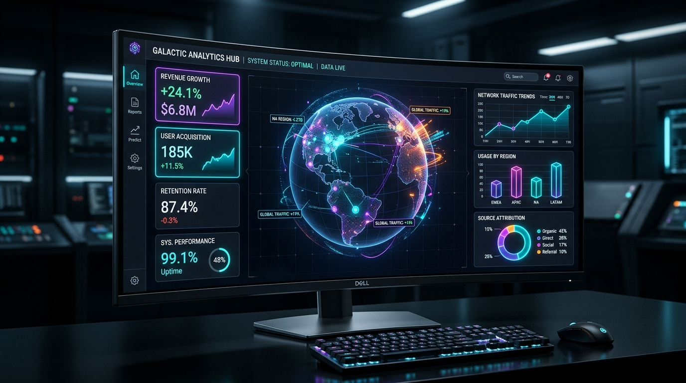

# OmniSight: Multi-Framework Visual Analytics Hub ⚡📊


**OmniSight** es una plataforma integral de analítica visual y panel de control (Dashboard) empresarial desarrollada por **Mauricio Arian Choqueña Choque**. El proyecto implementa, compara y unifica de manera armónica las principales herramientas del ecosistema de datos: **Streamlit**, **Plotly (Dash Engine)**, **Seaborn**, **Matplotlib** y **Bokeh**, integrando un flujo automatizado de entrega continua (**CI/CD con GitHub Actions**) hacia la nube (**Streamlit Community Cloud** y **Render SaaS**).



---

## 🔗 Enlaces Rápidos del Proyecto

| Recurso | Enlace Directo |
| :--- | :--- |
| 🌐 **Aplicación en Vivo (Cloud SaaS)** | [mauchoquenachoque-visualization-dashboard.streamlit.app](https://mauchoquenachoque-visualization-dashboard.streamlit.app) |
| 📂 **Repositorio Público GitHub** | [github.com/mauchoquenachoque/Visualization-Reports-or-Dashboard---MCC](https://github.com/mauchoquenachoque/Visualization-Reports-or-Dashboard---MCC) |
| 📝 **Artículo Técnico en Dev.to** | [Leer en Dev.to](https://dev.to/mauricio_arianchoqueac/building-deploying-next-gen-analytical-dashboards-streamlit-vs-dash-vs-seaborn-in-the-cloud-4l1a) |


---

## 🎯 Características Principales

1. **Centro de Mando Ejecutivo (KPIs):**
   - Tarjetas métricas animadas con estilo *Dark Glassmorphism* (Ingresos, Beneficio, CSAT, Latencia de SLA, Uptime 99.9%).
   - Cálculo dinámico de deltas porcentuales en base a los filtros seleccionados.

2. **Visualizaciones Interactivas con Plotly:**
   - **Dispersión 3D Multidimensional:** Ingresos vs Margen de Beneficio vs CSAT Score agrupados por categoría.
   - **Mapa Coroplético Global:** Distribución de facturación internacional por país en proyección *Natural Earth*.
   - **Series de Tiempo Financieras:** Evolución temporal con cálculo automático de media móvil de 7 días.
   - **Gráficos de Radar:** Evaluación multidimensional de rendimiento por categoría tecnológica.

3. **Análisis Estadístico Avanzado con Seaborn:**
   - **Estimación de Densidad de Kernel (KDE):** Distribución de probabilidad de ingresos por categoría de producto.
   - **Diagramas de Violín:** Distribución de cuartiles y asimetría de beneficios operativos por región global.
   - **Matriz de Correlación de Pearson:** Mapa de calor paramétrico con coeficientes de correlación bivariados.
   - **Modelos de Regresión Lineal:** Impacto de la latencia del sistema sobre la satisfacción del cliente (CSAT).

4. **Matriz Comparativa de Herramientas:**
   - Tabla comparativa detallada: **Streamlit vs Plotly/Dash vs Seaborn vs Bokeh vs Shiny**.
   - Asistente de Decisión interactivo para orientar a desarrolladores y equipos según presupuesto y tiempo.

5. **Generador y Exportador de Reportes:**
   - Exportación del dataset filtrado en formato **CSV**.
   - Generación instantánea de **Resumen Ejecutivo en Markdown**.

---

## ⚖️ Comparativa Tecnológica de Herramientas de Visualización

| Criterio | ⚡ Streamlit | 📈 Plotly / Dash | 🔬 Seaborn & Matplotlib | 🌐 Bokeh | 💎 Shiny |
| :--- | :--- | :--- | :--- | :--- | :--- |
| **Ecosistema** | Python | Python / R / Julia | Python | Python | R y Python |
| **Curva de Aprendizaje** | **Muy Baja (Horas)** | Media-Alta | Baja-Media | Media-Alta | Media |
| **Reactividad** | Automática por script | Callbacks en React.js | Nula (Estático PNG) | WebSockets Server | Grafo Reactivo |
| **Despliegue Cloud** | **1-Click (Community Cloud)** | Contenedores / PaaS | Documentos / PDFs | Servidor Bokeh | Posit / Shinyapps |
| **Casos de Uso** | MVPs, Apps de IA, Data Science | Dashboards financieros masivos | EDA, Papers científicos | Streaming en tiempo real | Bioestadística y econometría |

---

## 🚀 Cómo Ejecutar el Proyecto Localmente (Fácil y Rápido)

Este proyecto está diseñado para que cualquier persona pueda ejecutarlo **sin configuraciones complejas**:

### Opción A: En Windows con 1 solo Clic (Recomendado)
Simplemente haz doble clic sobre el archivo:
```
run.bat
```
El script verificará e instalará automáticamente las dependencias y abrirá el Dashboard en tu navegador por defecto.

---

### Opción B: Por Consola / Terminal (Windows, macOS o Linux)

1. **Clonar el repositorio:**
   ```bash
   git clone https://github.com/mauchoquenachoque/Visualization-Reports-or-Dashboard---MCC.git
   cd Visualization-Reports-or-Dashboard---MCC
   ```

2. **Instalar dependencias:**
   ```bash
   pip install -r requirements.txt
   ```

3. **Iniciar el Dashboard:**
   ```bash
   streamlit run app.py
   ```
   *La aplicación se abrirá automáticamente en `http://localhost:8501`.*

---

## 🔄 Automatización CI/CD y Despliegue en la Nube

El proyecto incorpora un flujo de ingeniería DevOps profesional:

```mermaid
graph LR
    Dev[💻 Mauricio Choqueña] -->|git push origin main| GH[🐙 GitHub Repo]
    GH -->|Trigger| Actions[⚙️ GitHub Actions CI]
    subgraph CI Pipeline
        Actions --> Step1[📦 Setup Python 3.11]
        Step1 --> Step2[📥 Install Dependencies]
        Step2 --> Step3[🧪 Test Data Generation]
        Step3 --> Step4[✅ Syntax py_compile]
    end
    CI Pipeline -->|Webhook Automático| Cloud[☁️ Streamlit Community Cloud]
    Cloud -->|Deploy Continuo| Prod[🚀 Live Web App Pública]
```

- **Pipeline CI:** Definido en `.github/workflows/ci-cd.yml`.
- **Despliegue CD:** Automatizado mediante webhook directo entre GitHub y **Streamlit Community Cloud** (y compatible con **Render SaaS** mediante `render.yaml`).
- **Contenedorización:** Incluye `Dockerfile` para despliegues en Google Cloud Run, AWS ECS o Hugging Face Spaces.

---

## 📁 Estructura del Repositorio

```
Visualization-Reports-or-Dashboard---MCC/
├── .github/
│   └── workflows/
│       └── ci-cd.yml             # Workflow de GitHub Actions
├── .streamlit/
│   └── config.toml               # Tema visual Dark Cyber
├── assets/
│   └── dashboard_banner.jpg      # Banner e imagen de portada
├── components/
│   ├── kpi_cards.py              # Tarjetas KPI con CSS glassmorphism
│   ├── charts_plotly.py          # Gráficos interactivos 2D/3D Plotly
│   ├── charts_seaborn.py         # Análisis estadístico con Seaborn
│   ├── comparison_engine.py      # Matriz comparativa y recomendador
│   └── report_generator.py       # Exportador de reportes CSV y MD
├── data/
│   ├── sample_data.py            # Generador determinístico de datos
│   └── sales_and_metrics.csv     # Conjunto de datos offline
├── app.py                        # Aplicación principal Streamlit
├── requirements.txt              # Dependencias del proyecto
├── Dockerfile                    # Configuración de contenedor Docker
├── render.yaml                   # Definición de infraestructura en Render
├── run.bat                       # Lanzador en 1 clic para Windows
├── run.sh                        # Lanzador para Linux/macOS
├── dev_to_article.md             # Artículo completo listo para Dev.to
├── script_video_5min.md          # Guion técnico para video de 5 minutos
├── telegram_message.txt          # Plantilla lista para grupo de Telegram
├── LINKS_ENTREGA.txt             # Resumen de enlaces oficiales
├── generate_pdf_report.py        # Generador del informe académico en PDF
└── INFORME_FINAL_MAURICIO_CHOQUENA.pdf # Informe final en formato PDF
```

---

## 👨‍💻 Autor

- **Estudiante:** Mauricio Arian Choqueña Choque
- **GitHub:** [@mauchoquenachoque](https://github.com/mauchoquenachoque)
- **Repositorio:** [Visualization-Reports-or-Dashboard---MCC](https://github.com/mauchoquenachoque/Visualization-Reports-or-Dashboard---MCC)

---
*Proyecto académico desarrollado para la asignatura de Visualización de Datos y Despliegue en la Nube © 2026.*
